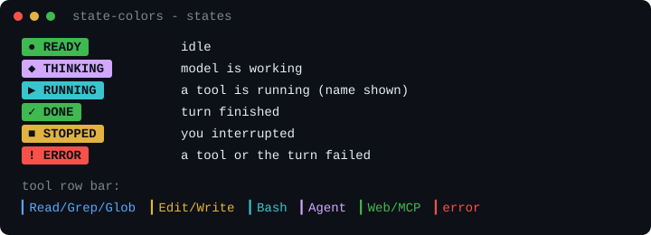

# state-colors

A Claude Code mod that puts a **colored live band above your prompt**, so you can see at a glance what Claude is doing, what its subagents are thinking, and which tools they are running.



> The images here are drawn mock-ups of the real terminal UI, not captures of a live session.

## What you get

| Part | What it shows |
| --- | --- |
| **State badge** | A filled color pill: ready, thinking, running (with the tool name), done, stopped or error. |
| **Timer and tool count** | Seconds and number of tool calls for the current or last turn. |
| **Agents row** | One chip per live subagent (`Explore:running`), refreshed every second. |
| **Agent thinking** | The tail of what each subagent is saying or thinking right now. |
| **Agent tool trail** | Its last three tool calls, each colored by kind. |
| **Tool row bar** | A colored `▎` at the left of every tool call in the transcript. |
| **Long-turn toast** | A toast such as `✓ done after 47s` when a turn takes 30 s or more. |



## Install

At the prompt of a terminal session:

```
/plugin install state-colors --marketplace amyyne01/claude-state-colors
```

From a shell:

```
claude plugin install state-colors --marketplace amyyne01/claude-state-colors
```

Answer `y` to add the marketplace, then pick a scope. The mod is active in that session straight away and in every later one.

## How it works

It is a single hooks module (`hooks/register.tsx`) with no dependencies:

- `turn.start`, `tool.call` and `turn.complete` keep the current state in `$.state`.
- A `ui.render` hook on `AbovePrompt` draws the badge and the agents row from that state.
- A `ui.render` hook on `ToolUse` adds the colored bar to each tool row.
- A `turn.step` stream hook reads each subagent's thinking, and `$.agent.list()` supplies the chips. Both are buffered and flushed once a second so streaming never redraws on every token.

## Customize

Everything lives in `hooks/register.tsx`:

- `LOOK` sets the badge colors, icons and labels.
- `TOOL_COLOR` maps tool names to bar colors.
- The `secs >= 30` check in `turn.complete` sets the toast threshold.

Colors are the terminal's named colors (`green`, `magenta`, `cyan`, ...), so they follow your terminal theme.

## Limits

- **Terminal only.** `$.theme.set` themes paint in the desktop and mobile apps, not the terminal, so this mod colors only the elements a terminal mod can reach.
- **Tool bar is one character.** The terminal's `Box` has no left-only border, so on multi-line tool output only the first line carries the bar.
- **No colored status line.** The engine draws a mod's status line in plain warning style, so the colors live in the band instead.
- **Subagents only.** Background shell tasks are not tracked, because the API lists agents, not shell jobs.

## License

MIT
